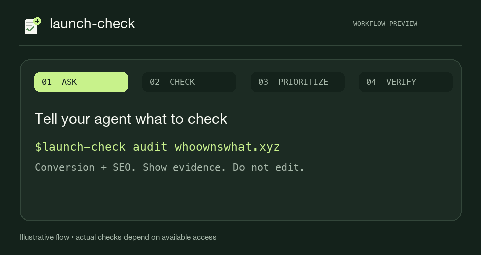

<p align="center">
  
</p>

<h1 align="center">Launch Check</h1>

<p align="center"><strong>Build a clearer page. Find what is broken. Launch with evidence.</strong></p>

<p align="center">A practical Agent Skill for website builds, conversion and SEO audits, and launch checks in Codex, Claude Code, and other skill-compatible coding agents.</p>

<p align="center">
  <a href="#try-it-in-one-prompt">Try a prompt</a> ·
  <a href="#install">Install</a> ·
  <a href="#built-with-launch-check">Built with it</a> ·
  <a href="https://whoownswhat.xyz/">See WhoOwnsWhat</a>
</p>

<p align="center">
  
</p>

<p align="center"><sub>Illustrative workflow preview. Findings depend on the site and the tools your agent can access.</sub></p>

## What you can do with it

- **Build:** turn a product brief into a landing page with a clear offer, working action, mobile layout, and basic search metadata.
- **Research:** find audience questions and search intent, then map useful pages. It labels missing keyword volume instead of making up numbers.
- **Audit:** check the message, every visible CTA, trust, footer links, accessibility, technical SEO, and AI readability. Get a short, prioritized list of fixes with evidence.
- **Implement:** fix selected issues in the existing site without replacing a design that already works.
- **Launch:** verify the deployed page, links, analytics when selected, sitemap, search submission where account access exists, and IndexNow for eligible new sites.

Launch Check is **a set of instructions for your coding agent**, not a hosted audit service or a one-command CLI. It uses the repository, browser, and connected accounts you give the agent. It separates what it checked from what it could not verify.

## Try it in one prompt

Paste this into an agent chat after installation:

```text
$launch-check audit https://whoownswhat.xyz/ for conversion and SEO.
Tell me what is clear, what is confusing, and which fixes matter first.
Check the visible CTAs, mobile layout, technical SEO, sitemap, and footer.
Show evidence and mark anything you could not verify. Do not change the site.
```

You can also ask it to **build**, **research**, **implement**, or **launch**. For a full release, name the repository, hosting project, and domain, and explicitly ask it to publish. See the [complete usage guide](docs/USAGE.md) for copyable prompts for every mode.

## Install

Copy the whole [`skills/launch-check`](skills/launch-check) folder, including its references and assets, into your agent's skills directory:

```text
Codex:       ~/.agents/skills/launch-check/
Claude Code: ~/.claude/skills/launch-check/
```

Use your agent's skill selection syntax, such as `$launch-check` in Codex or `/launch-check` in Claude Code. Then paste one of the prompts above. The skill has no mandatory paid service or runtime dependency. Browser, repository, Search Console, and analytics access are needed only for checks or changes that use them.

Already installed? Say **“Update launch-check from GitHub to the newest version”** in your coding agent, or run the [included updater](skills/launch-check/scripts/update_from_github.py). It checks the `main` branch, backs up older installed copies, and updates on `--apply`.

## Built with Launch Check

These are projects from [avo42](https://avo42.com/). They show different kinds of pages and products the skill has helped build or check.

| Project | What it does |
| --- | --- |
| [WhoOwnsWhat](https://whoownswhat.xyz/) | Shared ledger for co-founders to split project costs, track asset ownership, and hand things over cleanly. My latest project, still in development. |
| [MakeSquishy](https://makesquishy.com/) | Free tool for kids to design, print, and fold paper squishies. |
| [PadelTune](https://padeltune.wattmarchol.chatgpt.site/) | Personal padel training plans for strength, mobility, and match prep. |
| [ReadNext](https://readnext-reading-room.wattmarchol.chatgpt.site/) | Helps pick one book to read next from an overflowing want-to-read shelf. |
| [PlateWeek](https://plateweek.avo42.com/) | Turns a food video into recipes and a practical shopping list. |
| [Armando](https://armando.avo42.com/) | Client management playbook and follow-through for agencies and consultancies. |
| [AI Shift Field Guide](https://avo42.com/ai-shift/) | Plain-language guide to AI shifts in software, with a checklist for testing product ideas. |
| [AI Markets, explained](https://avo42.com/ai-markets/) | A practical reading of AI spending, adoption, and where new products may fit. |

## How it handles SEO research

The default research path uses accessible, attributable sources. The agent checks intent and the actual search results, then turns promising topics into page briefs. Numeric volume or difficulty appears only when a connected source supplies it. **DataForSEO can add live keyword and SERP data**, but it is optional and may have its own cost; the skill does not pretend that it is connected by default.

For search discovery, the launch workflow checks canonicals, `robots.txt`, generated sitemaps, and Google/Bing submission when the right accounts are available. IndexNow can notify participating engines about page changes. None of these steps guarantees indexing or ranking.

## More detail

- [Complete usage guide](docs/USAGE.md): install/update steps, all five modes, full prompts, GA4, legal pages, and Is Agentic.
- [Website launch walkthrough](docs/LAUNCH-A-WEBSITE.md): from brief to verified production page.
- [Skill instructions](skills/launch-check/SKILL.md): the agent entry point and scoped reference modules.
- [Roadmap](ROADMAP.md) · [Changelog](CHANGELOG.md) · [Licensing status](LICENSE-NOTICE.md)

I have been iterating on the public repo since late September 2026. Suggestions and real-world edge cases are welcome in [GitHub Issues](https://github.com/matt-warchol/launch-check/issues).
